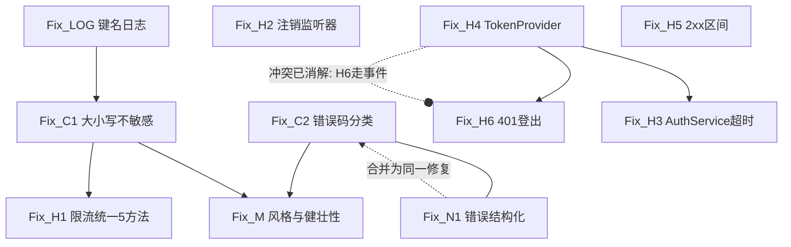

# HttpClient 代码审查报告 v3（复核版）

> 工具链：`arkts-expert` skill — Stage 1 微逻辑 + Stage 2 服务层结构审查（参照系①②③④）
> 复核日期：2026-09-08 ｜ 前版：v2（2026-09-04）
> 被审文件：`entry/src/main/ets/services/HttpClient.ets`（137 行，全文扫描）

---

## 1. 项目检测（MANDATORY 顶部块）

| 项 | 结论 |
|---|---|
| 目标 API | **HarmonyOS 6.1.0(23)** = API 23（远超 API 12；V2 状态管理可用，本文件不涉及） |
| 兼容 API | 6.1.0(23)，无低版本兼容包袱 |
| 严格模式 | `caseSensitiveCheck: true` + `useNormalizedOHMUrl: true`（**import 路径大小写敏感**） |
| 被审对象角色 | **服务类/传输层封装**（非 UI）→ 走服务层审查流程，**不套用状态管理规则** |
| 导航 | Navigation + NavPathStack（本文件不涉及） |

**扫描范围（本次全部读完，无跳过）**
- 主审：`HttpClient.ets`（137 行，5 个请求方法 + 2 个工具方法）
- 兄弟/依赖：`AuthService.ets`(366)、`RateLimitService.ts`(71)、`RateLimitInfo.ts`(35)、`APIConstants.ets`(27)、`RateLimitPage.ets`(119)
- 调用点：6 个 Repository + 5 个页面的 34 处 `HttpClient.*` 调用
- 平台核验：`@ohos.net.http.d.ts`（本地 SDK `default/openharmony/ets/api/`）

**未扫描**：`entry/src/main/ets/common/models/` 下业务模型定义（不影响本次结论，仅影响 M5 的字段级核对）。

---

## 2. 本次复核结论（与 v2 的差异）

`git status` 显示：**v2 报告提出的所有问题一条都没修**，代码自 `66027ee`(9/3) 起仅新增了限流链路，且**尚未提交**（`RateLimitService.ts` / `RateLimitPage.ets` / `models/` 均为未跟踪文件）。

| 维度 | v2 → v3 变化 |
|---|---|
| C1 限流头大小写 | ❌ 未修，**仍是最严重问题**。本次补到 SDK 行级证据 |
| C2 网络错误死分支 | ❌ 未修 |
| H1 限流只覆盖 `get` | ⚠️ **本次新增引入**（v2 时还没有限流链路，v2 的 H1 是预警，现在是实锤） |
| H2 监听器泄漏 | ⚠️ **本次新增引入**，已核实 `RateLimitPage` 确实无 `aboutToDisappear` |
| H3 AuthService 裸写无超时 | ❌ 未修（已重读确认：两处 `request` 均未设超时） |
| H4 传输层依赖业务服务 | ❌ 未修。**新增的 `RateLimitService` 依赖方向是正确的**（services → common/utils ✅） |
| H5 204 硬编码 | ❌ 未修；已核实当前唯一调用点是 star/unstar，**暂不触发** |
| H6 401 不清登录态 | ❌ 未修 |
| 新增 | 🟠 N1 中文文案跨文件耦合（`'配额已用完'` 子串嗅探）｜🟡 N2 `RateLimitService` 用 `.ts` 与全工程 `.ets` 不一致 |

---

## 3. 阶段一：问题诊断

### Summary

137 行的 GitHub REST 传输层封装。语法层面干净：无 `any/unknown`、全部显式返回类型、`finally + destroy()` **5/5 覆盖**、超时 5 处统一 15s——lint 能查的都过了。

但按服务层三参照系核对，**本次新接入的限流链路整体处于"写完但没生效"的状态**：三个隐藏的不可达分支让 `RateLimitPage` 永远显示"暂无速率限制数据"，精心写的中文配额提示永远不会出现。叠加 v2 遗留的网络错误死分支，用户可感知的缺陷共 2 个 CRITICAL、7 个 HIGH。

---

### 🔴 C1. `X-RateLimit-*` 取值方式大概率恒为 undefined，整条限流链路静默失效

**位置**：`HttpClient.ets:46` → `RateLimitService.ts:37-42` ｜**参照系**：② 平台运行时

**Evidence**：
```arkts
// HttpClient.ets:46
RateLimitService.parseHeaders(res.header as Record<string, string>);
// RateLimitService.ts:37-42
const limitStr: string | undefined = headers['X-RateLimit-Limit'];
if (!limitStr || !remainingStr || !resetStr) return;   // ← 静默早退，无日志
```

三条独立证据指向键名大小写错误：
1. **SDK 声明**：`HttpResponse.header: Object`（`@ohos.net.http.d.ts:2499`）；
2. **官方示例一律全小写取值**：`header['content-type']`、`header['status-line']`、`:2489-2491`；
3. **协议层**：`api.github.com` 支持 HTTP/2，HTTP/2 规范强制 header 名为小写（驼峰键必然取不到）。
4. **本项目既往实证**（工作区 MEMORY）：取 `X-RateLimit-*` 这类驼峰头必须做大小写不敏感查找。

**Impact（用户可感知）**：
- `RateLimitPage` 永远停在"📊 暂无速率限制数据"，说明文案"执行一次 API 请求后自动获取"变成误导——用户执行了很多次也不会有数据；
- `checkAndGetError()` 恒返回 `null` → `HttpClient.ets:49-52` 那个 403/429 分支**永远不抛**，"API 请求配额已用完（剩余 0/5000），x分x秒后重置"这句提示用户一辈子看不到，只看到笼统的"请求过于频繁，请稍后重试"；
- 失效完全静默（catch 里空实现），无任何日志，定位成本极高。

**未 100% 定论的部分**：HarmonyOS 网络栈与 GitHub 若协商回落 HTTP/1.1，GitHub 会返回驼峰头——此时代码是对的。**一行日志即可定案**，且无论结论如何都应改成大小写不敏感写法（见阶段二 Fix_C1）。

---

### 🔴 C2. 网络失败的中文提示是死分支，用户看到 curl 原始英文错误

**位置**：`HttpClient.ets:20` + `:54-57` ｜**参照系**：② 平台运行时 + 服务层反模式清单

**Evidence**：
```arkts
if (msg === 'NETWORK_ERROR') return '网络连接失败，请检查网络';   // :20 唯一消费者
} catch (e) {
  if (e instanceof Error) { throw e; }
  throw new Error('NETWORK_ERROR');                                // :56 唯一生产者 → 不可达
}
```

`arkts-limited-throw` 规定只能抛 `Error` 子类，`@ohos.net.http` 在断网/超时/证书失败时 reject 的是 `BusinessError`（同为 `Error` 子类）→ `e instanceof Error` **恒真** → `throw new Error('NETWORK_ERROR')` **永不执行**。

**Impact**：断网/超时时 `formatError` 走到 `return msg`，把网络栈原始英文 message（curl 体系文本，如 `Response timeout`、错误码 2300028 之类）直接显示在页面上。中文兜底写了但从未生效。与记忆里"平板端偶发网络问题"属同一链路。

同样的死分支在 `postRaw`/`post`/`put`/`delete` 中以 `throw new Error(JSON.stringify(e))` 出现 4 次（`:77`、`:97`、`:115`、`:133`），既是死代码也是官方反模式（应 `as BusinessError` 取 `code`）。

---

### 🟠 H1. 限流关注点只覆盖 `get`，其余 4 个方法全裸（本次新增引入）

**位置**：`HttpClient.ets:46,49-52` 仅存在于 `get` ｜**参照系**：① 兄弟方法矩阵

| 方法 | 鉴权 | 限流解析 | 限流错误 | 超时 | 重试 | 资源释放 | 成功码 | body 解析 |
|---|---|---|---|---|---|---|---|---|
| `get` | ✅ | ✅ | ✅ | 15s/15s | ❌ | ✅ | 200 | ✅ |
| `postRaw` | ✅ | ❌ | ❌ | 15s/15s | ❌ | ✅ | 200/201 | ✅ |
| `post` | ✅ | ❌ | ❌ | 15s/15s | ❌ | ✅ | 200/201 | ✅ |
| `put` | ✅ | ❌ | ❌ | 15s/15s | ❌ | ✅ | **204 only** | — |
| `delete` | ✅ | ❌ | ❌ | 15s/15s | ❌ | ✅ | **204 only** | — |

**Impact**：GitHub 的 primary/secondary 限流对**所有动词**生效。发 issue（`post`）、star/unstar（`put`/`delete`）撞上 403 时，用户拿不到任何配额信息；且配额 UI 只跟随 GET 刷新，写操作后显示的是陈旧数据。

### 🟠 H2. `RateLimitPage` 注册监听器后从不注销 → 静态数组泄漏（本次新增引入）

**位置**：`RateLimitPage.ets:15-18`

```arkts
aboutToAppear(): void {
  this.rateLimit = RateLimitService.getInfo();
  RateLimitService.onChange((info: RateLimitInfo) => { this.rateLimit = info; });
}
// 无 aboutToDisappear；全工程零处调用 offChange()
```

**Impact**：`_listeners` 是静态数组，每进一次页面 push 一个捕获 `this` 的闭包。进 N 次就有 N 个僵尸监听器，每次响应给 N 个已销毁组件赋值——页面反复进出后内存持续增长。

### 🟠 H3. `AuthService` 绕过 HttpClient 裸写两套 OAuth 请求，且完全没设超时

**位置**：`AuthService.ets:286-297, 325-337`

| | HttpClient | AuthService 裸写 |
|---|---|---|
| 超时 | connect/read 各 15s | **未设置 → 平台默认 60000ms** |
| 限流解析 | 有（仅 GET） | 无 |
| 错误分类 | `formatError` 统一 | 各自拼字符串 |

**Impact**：弱网下 Device Flow 登录要**卡 60 秒**才报错，其它接口 15 秒就失败。同时 `HttpClient.postRaw`（`:60-79`）**全工程零调用者**——它本就是为"非 api.github.com 基址 + 自定义头"准备的，写了没用上。

### 🟠 H4. 传输层 import 业务服务，依赖方向倒置

**位置**：`HttpClient.ets:3` — `import { AuthService } from './AuthService';`

参照系④要求传输层不得 import 业务服务。`AuthService` 目前**没有**反向 import，所以**尚未成环**，但方向已错：一旦按 H3 的修法让 `AuthService` 复用 `HttpClient.postRaw`，立刻 A→B→A。

> 注：本次新增的 `RateLimitService`（`common/utils/`）方向是**正确的**（services → common ✅）。

### 🟠 H5. `put`/`delete` 硬编码只认 204

**位置**：`HttpClient.ets:110, 128` ｜**参照系**：③ 上游契约

| 端点 | 动词 | 成功码 |
|---|---|---|
| `PUT /user/starred/{o}/{r}`（**当前唯一调用者**，已核实） | PUT | 204 ✅ |
| `PUT /notifications`（全部已读） | PUT | **205** |
| `PUT /repos/{o}/{r}/subscription`（watch） | PUT | **200 + body** |

**Impact**：当前只有 star/unstar，**暂时不会触发**；但方法名是通用的，接入通知已读/watch 后会把成功判成失败。

### 🟠 H6. 401 只提示不清登录态，用户卡在"已登录但全部失败"

**位置**：`HttpClient.ets:15`

**Impact**：token 被吊销时返回"授权已失效，请重新登录"，但**没有任何地方**清理 `AppStorage` 的 `authToken`/`isLoggedIn` 或跳登录页。用户停在登录态，每个页面都重复报同一句话。

### 🟠 N1（新增）. 两个文件通过中文文案字面量耦合，且该分支恒不可达

**位置**：`HttpClient.ets:11` ← → `RateLimitService.ts:69`

```arkts
// HttpClient.ets:10-11
// 速率限制错误直接返回（已包含详细信息）
if (msg.indexOf('配额已用完') >= 0) return msg;
```
```typescript
// RateLimitService.ts:69
return 'API 请求配额已用完（剩余 ' + remaining + '/' + info.limit + '），' + reset;
```

**Impact**：传输层靠**子串匹配中文提示文案**来判断错误类型——改一个字（比如把"用完"改"耗尽"）就静默失效，且没有任何编译期或运行期信号。这是"结构化数据 → 字符串 → 反解析"反模式的加强版（v2 的 M2）。叠加 C1 后该分支目前**从未被触发**。

---

### 🟡 MEDIUM

| # | 位置 | 问题 |
|---|---|---|
| M1 | `:77,97,115,133` | `throw new Error(JSON.stringify(e))` ×4：死代码 + 官方反模式（应 `as BusinessError` 取 `code`） |
| M2 | `:12-18` vs `:53/74/94/111/129` | 结构化状态码 → 字符串 → 正则反解析；且错误消息格式不统一（`HTTP 404` vs `HTTP 404 for /repos/a/b`） |
| M3 | `:42-43,70-71,90-91,107-108,125-126` | 15s 超时硬编码 5 处 |
| M4 | `:47,73,93` | `JSON.parse` 未包装：空 body / HTML 错误页 / 网关篡改响应会抛英文 `SyntaxError` 直透 UI |
| M5 | 6 个 Repository 共 20+ 处 | `HttpClient.get<Object>` 泛型退化为 `Object`，`as T` 无运行时校验 |
| M6 | 全部方法 | 无重试。GitHub 偶发 502/503；**平台无内建重试 API**（不建议"连接池/自动重试配置"，属概念泄漏） |
| M7 | 全文件 | 缺 `PATCH`（GitHub 编辑类接口官方推荐 PATCH）。当前无调用需求 |
| M8 | `:3` | 两条 `import` 挤在同一行（本次新增 RateLimitService 时造成）；`:65` 超长单行手工展开循环 |
| N2 | `RateLimitService.ts` | 全工程唯一 `.ts`（其余 51 个均为 `.ets`）。ArkTS 工程内混用扩展名，`useNormalizedOHMUrl` 开启下易踩解析差异 |

---

### 异常可达性真值表（catch/分支）

| 分支 | 可达性 | 结论 |
|---|---|---|
| `if (e instanceof Error) throw e;` | 恒真 | 有效路径 |
| `throw new Error('NETWORK_ERROR')`（get:56） | **恒不可达** | 死代码 → C2 |
| `throw new Error(JSON.stringify(e))`（×4） | **恒不可达** | 死代码 + 反模式 → M1 |
| `formatError` 的 `msg === 'NETWORK_ERROR'`（:20） | **恒不可达** | 死分支 → C2 |
| `formatError` 的 `msg.indexOf('配额已用完')`（:11） | **恒不可达**（因 C1） | 死分支 + 文案耦合 → N1 |
| `RateLimitService.parseHeaders` 三头判空早退 | **很可能恒真早退** | → C1 |
| `checkAndGetError()` 返回非 null | **恒 false**（因 C1） | → C1，`get` 的 403/429 分支形同虚设 |

### 平台能力验证门

- **连接池 / 单例连接 / 内建重试**：`@ohos.net.http` 三项均无 → **禁止建议**，重试须自实现（M6）。
- **拦截器链**：`HttpInterceptor`/`HttpInterceptorChain` 标注 **`@since 22`**（SDK `:711-905`），本项目 targetSdk 23 **可用**——鉴权/限流解析/错误分类三个横切关注点适合下沉拦截器，可从根上消除 H1 分叉（属重构，非缺陷修复）。
- **`destroy()`**：5/5 方法在 `finally` 中释放 ✅，符合官方强制要求。
- **`HttpResponse.header`**：类型 `Object`，官方示例全小写取值 → C1。

---

## 4. 阶段二：修复规划（**待确认后实施**）

> Planning Input：基于 v3 阶段一清单（2026-09-08）。本阶段不引入清单外新问题。

### Fix DSL

**Fix_C1 — 限流头改大小写不敏感取值**
- Target: `RateLimitService.parseHeaders`；Severity: CRITICAL
- Approach: 加私有 `pickHeader()`，遍历 `Object.keys` 做 `toLowerCase()` 比对，值统一 `String()` 包装；`resource` 同样处理
- Preconditions: 无
- Postconditions: HTTP/1.1 与 HTTP/2 下都能取到 `X-RateLimit-\*`；`_info` 有值
- Side_Effects: `RateLimitPage` 开始显示真实数据；`checkAndGetError()` 开始可能返回非 null（**激活** `get` 的 403/429 分支与 `formatError` 的"配额已用完"分支）
- Conflicts_With: 无（但它是 Fix_H1 的前置）

**Fix_LOG — 加一行 header 键名日志（验证用）**
- Target: `parseHeaders` 首行；Severity: MEDIUM
- Approach: `console.info('HDR ' + JSON.stringify(Object.keys(headers)))`，真机跑一次确认键名后删除
- Preconditions: 无 ｜ Postconditions: C1 定案 ｜ Side_Effects: 日志噪声（临时）

**Fix_H1 — 限流关注点统一到 5 个方法**
- Target: `HttpClient` 全部请求方法；Severity: HIGH
- Approach: 抽私有 `handleResponse(res, path)`：解析限流头 → 2xx 判定 → 403/429 限流错误映射；5 个方法共用
- Preconditions: **Fix_C1 已合入**（否则修好了调用点、数据依旧是空）
- Postconditions: 5 个方法的限流列全绿
- Side_Effects: 改动 5 个方法的错误抛出点；所有调用方（34 处）的错误文案可能变化，需回归

**Fix_H2 — `RateLimitPage` 注销监听器**
- Target: `RateLimitPage.ets:15-18`；Severity: HIGH
- Approach: 把回调存为成员 `listener`，`aboutToDisappear()` 调 `offChange(this.listener)`
- Preconditions: 无 ｜ Postconditions: 进出页面 N 次后 `_listeners.length` 稳定 ｜ Side_Effects: None

**Fix_C2 — 网络错误按 `BusinessError.code` 分类，删死分支**
- Target: `formatError` + 5 个 catch；Severity: CRITICAL
- Approach: 删 `'NETWORK_ERROR'` 哨兵与 `JSON.stringify(e)` 兜底；catch 内直接 rethrow；`formatError` 用 `(e as BusinessError).code` 对照 2300xxx（2300006 解析失败/2300007 连接失败/2300028 超时/2300094 认证错误）出中文；降级兜底不再透传英文原文
- Preconditions: 无
- Postconditions: 断网/超时显示中文；页面不再出现 curl 英文文本
- Side_Effects: `formatError` 新增对 `BusinessError` 的依赖路径（ArkTS 全局内置，无需 import）；与 N1 的中文子串判断并存 → **受 Fix_N1 影响**

**Fix_N1 — 错误类型结构化，去掉中文子串嗅探**
- Target: `formatError` + `RateLimitService`；Severity: HIGH
- Approach: 定义 `HttpError extends Error { statusCode: number }`（合法，非 any/unknown），限流错误单独成类或用 `statusCode + kind`；`formatError` 读字段而非子串
- Preconditions: 无
- Postconditions: 改文案不再影响控制流
- Side_Effects: 与 Fix_C2 同改 `formatError` → **两者须同批或合并**
- Conflicts_With: **Fix_C2**（同目标文件、同函数）→ Resolution: **合并为一个修复**，一次改完 `formatError`

**Fix_H4 — 抽 `TokenProvider`，解开传输层→业务服务依赖**
- Target: `HttpClient.ets:3`；Severity: HIGH
- Approach: 新建只依赖 AppStorage 的 `TokenProvider`，`buildHeaders()` 改用它
- Preconditions: 无 ｜ Postconditions: `HttpClient` 不再 import `AuthService`
- Side_Effects: 移除 `HttpClient → AuthService` 依赖边
- Conflicts_With: **Fix_H6**（H6 若直接调 `AuthService.logout()` 会加深该依赖边，与 H4 方向相反）→ Resolution: H6 改为发全局事件（如 `'AUTH_UNAUTHORIZED'`）由 Shell 处理，**或**先落地 H4 再由 H6 通过新接口触发

**Fix_H6 — 401 触发登出**
- Target: `get` 的 401 分支；Severity: HIGH
- Approach: 走全局事件，不直接调 `AuthService`
- Preconditions: **Fix_H4**（依赖反转先行）｜ Postconditions: 401 后登录态被清理 ｜ Side_Effects: 需 Shell/入口订阅事件
- Conflicts_With: Fix_H4（已由 Resolution 消解）

**Fix_H3 — `AuthService` 两个 OAuth 方法补超时 / 改用 `postRaw`**
- Target: `AuthService.ets:286,325`；Severity: HIGH
- Approach: 优先改调 `HttpClient.postRaw`（顺带消灭零调用者）；保守方案至少补 `connectTimeout/readTimeout: 15000`
- Preconditions: **Fix_H4**（若选用 postRaw 方案，否则立刻成环）
- Postconditions: 全 App 超时策略统一 15s
- Side_Effects: 登录链路错误文案变化，需回归登录流程

**Fix_H5 — 成功码改 2xx 区间判定**
- Target: `put`/`delete`（及 `get`/`post` 一并统一）；Severity: HIGH
- Approach: `res.responseCode >= 200 && res.responseCode < 300`
- Preconditions: 无 ｜ Postconditions: 205/200 的写请求不再误判 ｜ Side_Effects: 行为放宽，需回归 star/unstar

**Fix_M（M2/M3/M4/M8/N2 合并）— 结构与风格清理**
- Target: 全文件 + `RateLimitService.ts`；Severity: MEDIUM
- Approach: 超时常量化；`JSON.parse` 包 try/catch 转中文；import 拆行；`.ts` 改 `.ets`
- Preconditions: Fix_C2/N1 完成（避免二次冲突）｜ Postconditions: 无英文 `SyntaxError` 透传 ｜ Side_Effects: 文件扩展名变更需同步全部 import（caseSensitiveCheck 开启，路径必须精确）

### Fix Dependency Graph



边说明：
- `LOG → C1`：日志仅用于定案，可跳过（C1 的写法与结论无关）
- `C1 → H1` (depends on)：C1 不修，H1 覆盖再多也填不进数据
- `C2 ↔ N1` (alternative to → **建议合并**)：同函数改动
- `H4 → H6` / `H4 → H3` (depends on)：依赖反转先行
- `H4 -o H6` (conflicts with，已消解)：H6 不得直接调 `AuthService.logout()`

### Batches（依赖拓扑序）

| Batch | Fix IDs | 理由 |
|---|---|---|
| 1（验证） | Fix_LOG | 一行日志，真机跑一次给 C1 定案 |
| 2（用户可感知，改动小） | Fix_C1、Fix_H2 | 无前置依赖；修完限流 UI 立刻有数据 |
| 3（错误链路，一次提交） | Fix_C2 + Fix_N1（合并）、Fix_H5 | C2/N1 同函数必须一起改；H5 独立 |
| 4（依赖反转） | Fix_H4 | 为 H6/H3 铺路，解开依赖边 |
| 5（依赖 4） | Fix_H6、Fix_H3、Fix_H1 | H6/H3 依赖 H4；H1 依赖 C1（Batch 2 已完成） |
| 6（清理） | Fix_M | 依赖 3 完成，避免二次冲突 |

### Checklist（规划自检）
- [x] 所有修复填写了 DSL（Approach/Preconditions/Postconditions/Side_Effects）
- [x] Side_Effects 交集已检查：C1 的"激活 403/429 分支"与 H1 的调用点改动存在顺序依赖 → 已排入 Batch 2 先于 5
- [x] 冲突边 H4↔H6 已显式列出并给出 Resolution（H6 走事件）
- [x] C2 与 N1 同目标冲突 → 已合并为单批单修复
- [x] 批次顺序符合依赖拓扑（depends on 在前）
- [x] 未引入阶段一清单之外的新问题

---

## 5. 问题统计

| 级别 | 数量 | 条目 |
|---|---|---|
| 🔴 CRITICAL | 2 | C1 限流头取不到（整条链路静默失效）、C2 网络提示死分支 |
| 🟠 HIGH | 7 | H1 限流覆盖缺口、H2 监听器泄漏、H3 AuthService 无超时、H4 依赖倒置、H5 204 硬编码、H6 401 不清态、N1 中文文案耦合 |
| 🟡 MEDIUM | 9 | M1–M8、N2 |

## 6. Android 迁移说明

不适用。纯 ArkTS 实现，无 Android 概念泄漏（`java.io.File`、`FOREGROUND_SERVICE`、XML 布局均未出现）。

## 7. 输入不足（无法评估）

- 未扫描 `common/models/` 业务模型，M5 的字段级契约一致性无法评估。
- HarmonyOS 网络栈是否规范化响应头大小写，官方文档未说明 → C1 最终定性需一次真机日志（修法不受影响）。
